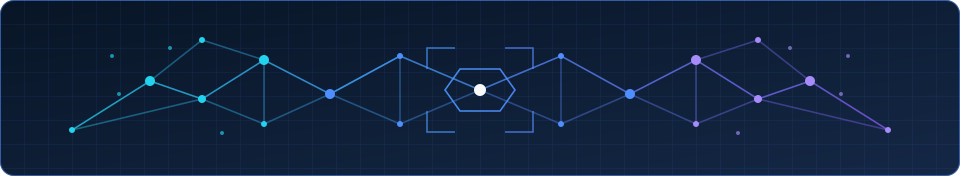

<h1>Hi, I'm Saad Sahraoui</h1>

**AI & Data Science Engineering Student | Machine Learning | Computer Vision | Full-Stack Development**

ENSAM Rabat · Mohammed V University · Morocco · Tanger  
*Ingénierie Numérique en Data Science, Intelligence Artificielle et Santé Digitale (INDIA)*

I build machine learning prototypes, business intelligence dashboards, and full-stack applications that take data from preparation to analysis, APIs, and user interfaces.

[![Download My Resume (PDF)][badge-cv]][cv] [![Email][badge-email]][email] [![GitHub][badge-github]][github] [![LinkedIn][badge-linkedin]][linkedin] [![Portfolio][badge-portfolio]][portfolio]

## About Me

I’m an engineering student based in Rabat, Morocco, specializing in AI and data science. I’m interested in industrial computer vision, business intelligence, customer analytics, data engineering, and backend development. I’m seeking PFA and PFE internships where I can contribute to applied AI, data, machine learning, or full-stack projects.

## Featured Projects

| Project | Domain | Tech Stack | Highlights | Repository |
| --- | --- | --- | --- | --- |
| **SocketHub-C** · TCP Chat & FTP | Network programming, systems | C11, WinSock2, PowerShell | Four native Windows programs: TCP messaging and passive FTP with file access checks and automated tests. | [Source][sockethub] |
| **Smart Industrial Maintenance BI** · MetroPT-3 | Business intelligence, industrial IoT | Power BI, Power Query (M), DAX, Python, LaTeX | Three dashboards analyze 1,516,948 sensor observations and four documented incident periods. | [Source][metropt-bi] |
| **Gripper Vision AI** · Industrial Gripper Prediction | Industrial AI, computer vision | Python, OpenCV, scikit-learn, Streamlit | Suggests gripper types for injection-molded parts from photos. | [Source][gripper] |
| **Customer Segmentation** · ML2 | Unsupervised ML, customer analytics | Python, pandas, NumPy, scikit-learn, Jupyter, Matplotlib, Seaborn | Benchmarks three clustering methods on 440 wholesale customers. | [Source][ml2] |
| **Smart Fraud Detection System** | Applied ML, fraud detection | Python, pandas, scikit-learn, XGBoost, FastAPI, Streamlit | Compares classifiers on imbalanced transaction data. | [Source][fraud] |
| **Data Processing API** | Data engineering, backend | Laravel, Python, MySQL, Redis | REST API backed by a Python ETL pipeline. | No public repository verified |
| **SaadRent** · Car Rental System | Full-stack development | Laravel 11, React 18, MySQL, Bootstrap 5, JWT | Vehicle search, reservations, and role-based dashboards. | [Backend][rental-backend] · [Frontend][rental-frontend] |

### SocketHub-C · TCP Chat & FTP

I built a university network programming project in C11 using WinSock2 on Windows. Four native programs implement a TCP messaging service and a passive FTP service with separate control and data connections. The shared I/O layer handles partial sends and line framing; the FTP server supports environment-configured credentials, file access checks under `ftp_root/`, and uploads without overwriting existing files. PowerShell scripts build the programs and exercise chat exchanges, file transfers, SHA-256 comparisons, and curl interoperability. Designed for local demonstrations, the services run on loopback without encryption.

![C11][tech-c] ![WinSock2][tech-winsock] ![GCC][tech-gcc] ![PowerShell][tech-powershell] ![CMD][tech-cmd] ![curl][tech-curl]

[View on GitHub][sockethub] · [Architecture][sockethub-architecture] · [Validation notes][sockethub-validation]

### Smart Industrial Maintenance BI · MetroPT-3

At ENSAM Rabat, I worked with Hassan El Hajjam and Yassine Saddane on a business intelligence project for a railway air compressor. We prepared the MetroPT-3 sensor data with Python and Power Query (M), built a dimensional model, and used DAX across three Power BI dashboard pages covering an overview, sensor monitoring, and incident analysis with OLAP. Of **1,516,948 sensor observations**, **29,954 (1.97%)** fell within the **four documented incident periods**. We documented the work in a LaTeX report.

![Power BI][tech-powerbi] ![Power Query (M)][tech-power-query] ![DAX][tech-dax] ![Python][tech-python] ![pandas][tech-pandas] ![LaTeX][tech-latex]

[View on GitHub][metropt-bi] · [Read the report (PDF)][metropt-report]

### Gripper Vision AI · Industrial Gripper Prediction

During my introductory engineering internship at Eurostyle Systems in Tangier, I built a prototype that suggests a gripper type for an injection-molded plastic part from a photo. OpenCV segments the part and extracts shape features for a scikit-learn Random Forest classifier. The Streamlit interface displays the segmentation and the suggested gripper type.

![Python][tech-python] ![OpenCV][tech-opencv] ![scikit-learn][tech-scikit-learn] ![Streamlit][tech-streamlit]

[View on GitHub][gripper]

### Customer Segmentation · ML2

I compared K-Means, Ward hierarchical clustering, and DBSCAN on six spending variables from the [UCI Wholesale Customers dataset][uci]. K-Means with two clusters offered the best compromise among the tested configurations. Its silhouette score was **0.2903**, compared with **0.2585** for Ward, both evaluated on all 440 customers. DBSCAN scored **0.2885** on the **210 non-noise observations** and classified **52.27%** of customers as noise. PCA was used only to visualize the clusters in two dimensions.

![Python][tech-python] ![pandas][tech-pandas] ![NumPy][tech-numpy] ![scikit-learn][tech-scikit-learn] ![Jupyter][tech-jupyter]

[View on GitHub][ml2]

### Smart Fraud Detection System

I built a pipeline to compare logistic regression, Random Forest, and XGBoost on imbalanced transaction data. The project includes a FastAPI prediction endpoint and a Streamlit dashboard for exploring the results.

![Python][tech-python] ![scikit-learn][tech-scikit-learn] ![XGBoost][tech-xgboost] ![FastAPI][tech-fastapi] ![Streamlit][tech-streamlit]

[View on GitHub][fraud]

### Data Processing API

I built a Laravel REST API with a Python ETL pipeline to prepare data for downstream use. The project uses MySQL indexing and Redis caching to support repeated queries.

![Laravel][tech-laravel] ![Python][tech-python] ![MySQL][tech-mysql] ![Redis][tech-redis]

### SaadRent · Car Rental System

I built a full-stack rental MVP with a Laravel REST API and a React frontend. Customers can browse vehicles and manage reservations, while administrators manage inventory and bookings through a separate dashboard. The API uses JWT authentication.

![Laravel][tech-laravel] ![React][tech-react] ![MySQL][tech-mysql] ![Bootstrap][tech-bootstrap]

View on GitHub · [Backend][rental-backend] · [Frontend][rental-frontend]

## Tech Stack

| Area | Tools |
| --- | --- |
| **Business Intelligence & Reporting** | ![Power BI][tech-powerbi] ![Power Query (M)][tech-power-query] ![DAX][tech-dax] ![LaTeX][tech-latex] |
| **Programming** |   Python, Java, C, C++, JavaScript, SQL |
| **Machine Learning & Data Science** |       scikit-learn, pandas, NumPy, OpenCV, XGBoost, Jupyter, Matplotlib |
| **Backend & Frontend** |  Laravel, PHP, React, Angular, HTML5, CSS3, Bootstrap |
| **Databases** |  MySQL, MongoDB, Redis |
| **Network Programming** | ![C11][tech-c] ![WinSock2][tech-winsock] ![GCC][tech-gcc] ![PowerShell][tech-powershell] ![CMD][tech-cmd] ![curl][tech-curl] TCP sockets, passive FTP, Win32 file APIs, Windows terminal workflows |
| **Developer Tools** |  Git, GitHub, Docker, VS Code, Linux |

## GitHub Activity

[![Profile views][badge-views]][github] [![GitHub followers][badge-followers]][followers]

Views are tracked by Komarev. The activity summary and language ranking come from GitHub Profile Summary Cards, and the streak comes from GitHub Readme Streak Stats.

[GitHub profile and contributions][github] · [Public repositories][repositories]

### 🏆 GitHub Trophies

## Certifications

**[Supervised Learning with scikit-learn](https://www.datacamp.com/courses/supervised-learning-with-scikit-learn)**

November 14, 2026 &middot; 4 hours

## Resume & Professional Profile

My resume covers my engineering education, technical skills, and selected projects for PFA and PFE internship opportunities.

[![Download My Resume (PDF)][badge-cv]][cv]

### ✍️ Random Dev Quote

## Let’s Connect

[![Email][badge-email]][email] [![LinkedIn][badge-linkedin]][linkedin] [![GitHub][badge-github]][github] [![Download My Resume (PDF)][badge-cv]][cv]

[cv]: ./saad_sahraoui_cv.pdf
[email]: mailto:saad20azmm@gmail.com
[github]: https://github.com/saadshr
[linkedin]: https://www.linkedin.com/in/saad-sahraoui/
[portfolio]: https://saadshr.github.io/
[followers]: https://github.com/saadshr?tab=followers
[repositories]: https://github.com/saadshr?tab=repositories
[sockethub]: https://github.com/saadshr/socket-network-programming
[sockethub-architecture]: https://github.com/saadshr/socket-network-programming/blob/main/docs/architecture.md
[sockethub-validation]: https://github.com/saadshr/socket-network-programming/blob/main/tests/validation.md
[metropt-bi]: https://github.com/saadshr/smart-industrial-maintenance-bi
[metropt-report]: https://github.com/saadshr/smart-industrial-maintenance-bi/blob/main/BI_MetroPT_Report/output/BI_MetroPT_Report.pdf
[gripper]: https://github.com/saadshr/gripper-vision-ai
[ml2]: https://github.com/saadshr/ml2-customer-segmentation
[fraud]: https://github.com/saadshr/fraud_detection
[rental-backend]: https://github.com/saadshr/carrental-backend
[rental-frontend]: https://github.com/saadshr/carrental-frontend
[uci]: https://archive.ics.uci.edu/dataset/292/wholesale+customers

[badge-cv]: https://img.shields.io/badge/Download%20My%20Resume%20%28PDF%29-125CB9?style=for-the-badge
[badge-email]: https://img.shields.io/badge/Email-A9420C?style=for-the-badge&logo=gmail&logoColor=white
[badge-github]: https://img.shields.io/badge/GitHub-6941C6?style=for-the-badge&logo=github&logoColor=white
[badge-linkedin]: https://img.shields.io/badge/LinkedIn-0E7490?style=for-the-badge
[badge-portfolio]: https://img.shields.io/badge/Portfolio-176B53?style=for-the-badge
[badge-views]: https://komarev.com/ghpvc/?username=saadshr&label=Profile%20Views&color=5B36A8&style=flat-square
[badge-followers]: https://img.shields.io/github/followers/saadshr?label=Followers&logo=github&color=125CB9&style=flat-square

[tech-python]: https://img.shields.io/badge/Python-125CB9?style=flat-square&logo=python&logoColor=white
[tech-powerbi]: https://img.shields.io/badge/Power%20BI-F2C811?style=flat-square&logo=powerbi&logoColor=111111
[tech-power-query]: https://img.shields.io/badge/Power%20Query%20(M)-176B53?style=flat-square
[tech-dax]: https://img.shields.io/badge/DAX-6941C6?style=flat-square
[tech-latex]: https://img.shields.io/badge/LaTeX-008080?style=flat-square&logo=latex&logoColor=white
[tech-opencv]: https://img.shields.io/badge/OpenCV-176B53?style=flat-square&logo=opencv&logoColor=white
[tech-scikit-learn]: https://img.shields.io/badge/scikit--learn-A9420C?style=flat-square&logo=scikitlearn&logoColor=white
[tech-streamlit]: https://img.shields.io/badge/Streamlit-A63661?style=flat-square&logo=streamlit&logoColor=white
[tech-pandas]: https://img.shields.io/badge/pandas-6941C6?style=flat-square&logo=pandas&logoColor=white
[tech-numpy]: https://img.shields.io/badge/NumPy-0E7490?style=flat-square&logo=numpy&logoColor=white
[tech-jupyter]: https://img.shields.io/badge/Jupyter-A9420C?style=flat-square&logo=jupyter&logoColor=white
[tech-xgboost]: https://img.shields.io/badge/XGBoost-6941C6?style=flat-square
[tech-fastapi]: https://img.shields.io/badge/FastAPI-176B53?style=flat-square&logo=fastapi&logoColor=white
[tech-laravel]: https://img.shields.io/badge/Laravel-A63661?style=flat-square&logo=laravel&logoColor=white
[tech-mysql]: https://img.shields.io/badge/MySQL-125CB9?style=flat-square&logo=mysql&logoColor=white
[tech-redis]: https://img.shields.io/badge/Redis-A9420C?style=flat-square&logo=redis&logoColor=white
[tech-react]: https://img.shields.io/badge/React-0E7490?style=flat-square&logo=react&logoColor=white
[tech-bootstrap]: https://img.shields.io/badge/Bootstrap-6941C6?style=flat-square&logo=bootstrap&logoColor=white

[tech-c]: https://img.shields.io/badge/C11-00599C?style=flat-square&logo=c&logoColor=white
[tech-winsock]: https://img.shields.io/badge/WinSock2-0078D4?style=flat-square
[tech-gcc]: https://img.shields.io/badge/GCC-A42E2B?style=flat-square&logo=gnu&logoColor=white
[tech-powershell]: https://img.shields.io/badge/PowerShell-5391FE?style=flat-square
[tech-cmd]: https://img.shields.io/badge/CMD-181717?style=flat-square
[tech-curl]: https://img.shields.io/badge/curl-073551?style=flat-square&logo=curl&logoColor=white
